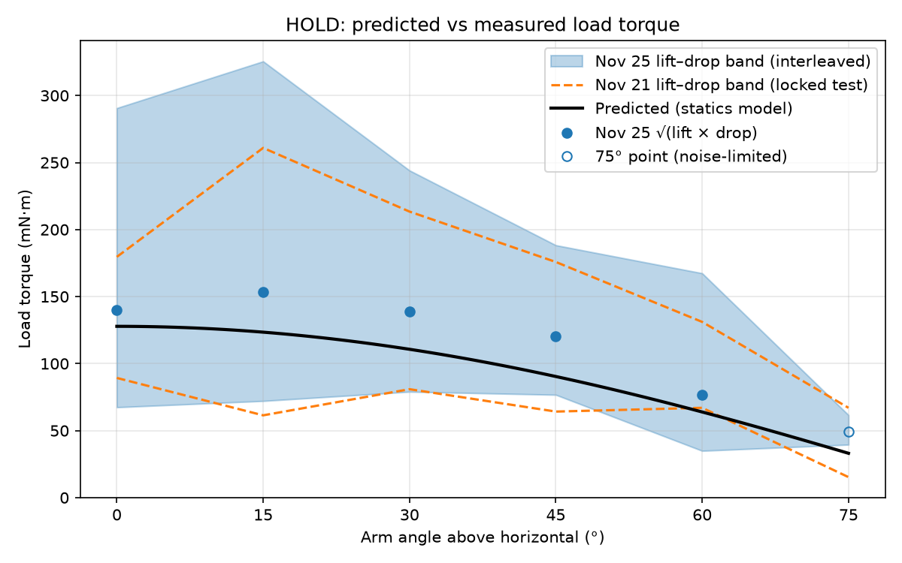

# HOLD: error analysis

**Result:** the locked prediction missed. Measured as the lift-threshold shift, the load torque read 41 to 111% high on Nov 21 and 86 to 164% high in an interleaved re-test on Nov 25, against a promised 20%. The likely cause is gearbox efficiency at breakaway. Lifting needs about load ÷ η, and back-driving passes about load × η. A drop-side test run to check this came out low, as predicted. Combining both sides to cancel η brings the estimate to within 10 to 33% at 0–60°. That combination was chosen after seeing the data, so it is reported alongside the locked result, not in its place.

## What was locked

- **Model:** statics, τ = m·g·r·cos θ. Load 43.44 g at 300 mm: 127.8 mN·m at horizontal.
- **Method:** load torque = (loaded lift threshold − unloaded lift threshold) × 27.9 mN·m per % duty, at 0, 15, 30, 45, 60 and 75°.
- **Calibration:** 27.9 mN·m per % from a stall test (the arm pressing on a kitchen scale, Nov 14).
- **Promise:** within 20% overall; within 10% if the stall calibration holds at breakaway.
- **Committed** in `data/prediction.md` (39b6282) before any sweep data. The 0° point was measured first and disclosed.

## What was measured (load torque, mN·m)

| Angle (°) | Predicted | Lift shift, Nov 21 | Lift shift, Nov 25 | Drop shift, Nov 25 | √(lift × drop), Nov 25 |
|---|---|---|---|---|---|
| 0 | 127.8 | 179.6 (+41%) | 290.6 (+127%) | 67.4 (−47%) | 140.0 (+10%) |
| 15 | 123.4 | 260.9 (+111%) | 325.5 (+164%) | 72.1 (−42%) | 153.2 (+24%) |
| 30 | 110.7 | 213.4 (+93%) | 244.1 (+121%) | 79.0 (−29%) | 138.9 (+26%) |
| 45 | 90.4 | 175.8 (+95%) | 188.3 (+108%) | 76.7 (−15%) | 120.2 (+33%) |
| 60 | 63.9 | 131.1 (+105%) | 167.4 (+162%) | 34.9 (−45%) | 76.4 (+20%) |
| 75 | 33.1 | 67.0 (+102%) | 61.6 (+86%) | 39.5 (+19%) | 49.3 (+49%) |

The secondary method, the shift of the band midpoint, read +5 to +55% on Nov 21 and +40 to +61% on Nov 25 (0–60°). Full data: `measurements.md` and `data/`.

## Causes ruled out

| Suspect | Test | Result |
|---|---|---|
| Wrong calibration slope | Recalibrated on the Mk3.1 arm at 300 mm (Nov 21) | 29.0 mN·m per %, 4% from 27.9. Can't explain 2× |
| Arm tilt during the Nov 14 calibration | Geometry check | Would need about 60° of tilt. Dropped |
| Motor heating (force decayed about 1% per second while held) | Touched the motor; estimated the heating rate | Motor cold; heating gives about 0.1% per second. Dropped |
| Drift between the loaded and unloaded sets (Nov 21 ran them an hour apart) | Interleaved re-test: unloaded then loaded at each angle (Nov 25) | Error got larger, not smaller. Not the main cause |
| Wrong load mass | Re-weighed (Nov 25) | 43.62 g against 43.44 g (+0.4%) |

## The explanation: gearbox efficiency at breakaway

A gearbox loses a fraction of the torque passing through it to tooth friction, and that friction grows with the load. With efficiency η:

- **Lifting:** the motor drives the gears and has to overcome the loss: shift ≈ load ÷ η. Reads high.
- **Dropping:** gravity back-drives the gears, and the loss resists the fall: shift ≈ load × η. Reads low.

Friction that doesn't depend on load (seals, bearings, no-load drag) cancels in the loaded − unloaded difference. Load-dependent friction doesn't cancel.

**Test:** if this is right, the drop shift should come out *below* the prediction, the opposite of the lift shift. It did, at every angle from 0 to 60° (−15 to −47%). The Nov 21 drop data agreed at 0–45° (−27 to −50%).

**Implied efficiency:** drop ÷ lift = η², so η = √(drop ÷ lift) = **0.46 to 0.64** (0–60°). That's plausible for a small multi-stage spur gearbox measured at breakaway, where static friction is at its limit. [Likely; η was not measured directly.]

**Combining both sides:** lift × drop = load², so load = √(lift × drop), and η cancels. This reads +10 to +33% at 0–60°. A plain average of lift and drop can't cancel η: it gives load × (1/η + η) ÷ 2, which is always high, and that's why the midpoint method missed.

**Why the calibration didn't see it (likely):** the stall calibration pressed on a scale with nothing sliding. Static friction then only takes up what it needs, so most of the motor's torque reaches the scale. At breakaway, static friction is at its maximum and works fully against the motion. Same gearbox, two friction states.

## What's still unexplained

- **A residual of +10 to +33%.** If η were the same in both directions, lift error × drop error would be 1.0. It's 1.2 to 1.8. Either the gearbox loses more driving than back-driven (common in gear trains, not tested here), or a scale error of about 20% remains. The 29.0 recalibration would make it 4% worse, not better.
- **Day-to-day variation.** Loaded lifts read about 4 points of duty higher on Nov 25 than on Nov 21; unloaded lifts matched. Not explained by the load mass.
- **Force decay during calibration** (about 1% per second). Scale creep not ruled out.

## Error budget

| Source | Size | Effect on load torque |
|---|---|---|
| Duty step | 0.25% | 7.0 mN·m per threshold (5% of the 0° prediction, 21% at 75°) |
| Threshold spread between trials | 0–2.75% duty (largest: unloaded drop at 0°) | Up to 77 mN·m on a single trial; averaged over 3 |
| Angle | ±2° (hold band and motion threshold) | Prediction changes by tan θ × 2°: under 1% at 0–15°, 3.5% at 45°, 13% at 75° |
| Backlash | about 4°, encoder on the motor side | The encoder reads the motor, not the arm, inside the slop |
| Calibration slope | 27.9 against 29.0 mN·m per % | 4% |
| Scale | 0.2% low (checked against quarters) | Negligible |
| Load mass | 43.44 against 43.62 g | 0.4% |

**75° is noise-limited.** The load signal there is 1.19% duty, about the size of the threshold spread, and the angle error alone is ±13%. The lock expected this.

## What I'd do differently

1. **Calibrate at breakaway, in both directions,** against a known torque, instead of in stall. The calibration has to see the same friction state as the measurement.
2. **Lock a method that uses both thresholds.** Lift alone carries the gearbox losses into the result by design.
3. **Measure gearbox friction directly,** driving and back-driven, to test whether the residual comes from unequal losses in each direction.
4. **Put the encoder on the output shaft,** so backlash doesn't sit between the measurement and the arm.